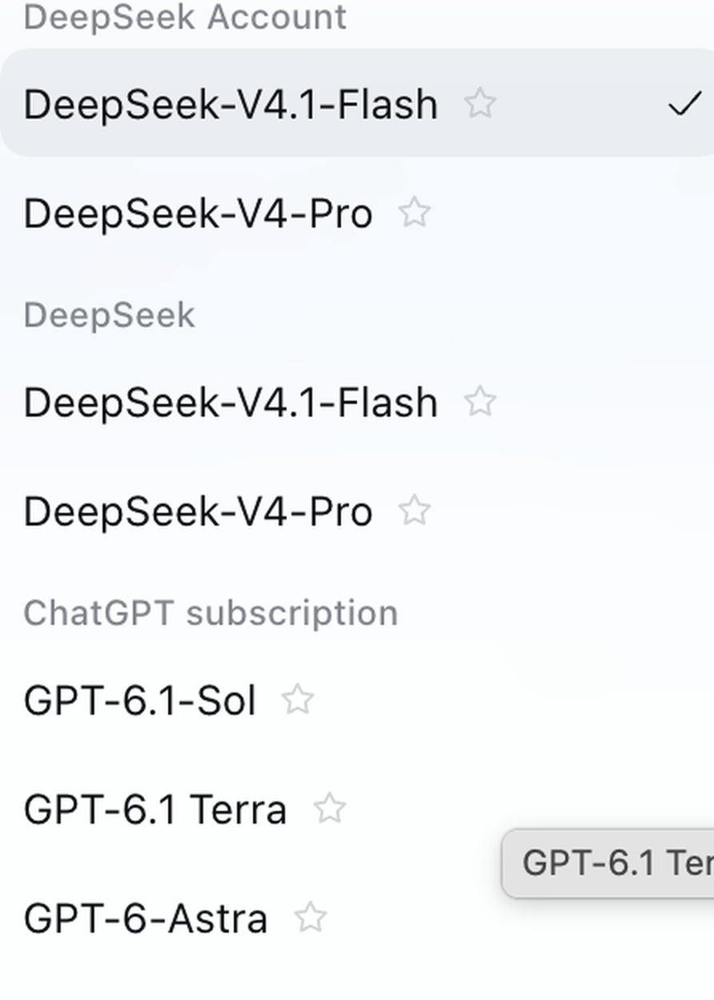

# Modelos favoritos para DeepSeek Harness

[](LICENSE)
[](https://github.com/deepseek-ai/deepseek-harness)
[](https://www.npmjs.com/package/dsh-favorite-models)

[English](README.md) | [Русский](README.ru.md) | [中文](README.zh.md) | [日本語](README.ja.md) | Español | [Français](README.fr.md) | [Deutsch](README.de.md) | [Português](README.pt.md)

Favoritos para el menú de modelos de DeepSeek Harness: los modelos a los que más vuelves, reunidos en un solo lugar.

| Lista de modelos con estrellas | El bloque Favoritos |
| --- | --- |
|  |  |

## Funciones

- Una estrella justo después del nombre de cada modelo en la lista.
- Haz clic en la estrella para añadir el modelo a favoritos; otro clic lo quita.
- Bloque **Favoritos** en el menú raíz del selector: los modelos marcados con su
  proveedor, una marca de verificación en el modelo actual y una estrella para
  quitarlo.
- Al hacer clic en un favorito se cambia a ese modelo y se cierra el menú.
- Los favoritos son comunes a todas las sesiones y sobreviven a un reinicio de DSH
  (se guardan en el `localStorage` del navegador).
- Localizado en todos los idiomas integrados de DSH; el cambio de idioma se aplica
  al instante, sin recargar.

## Instalación

Requisitos: DeepSeek Harness `0.2.2-rc.3` o posterior y la interfaz web (Desktop o
`dsh --profile web`).

### Opción 1 — Plugin Market (Discover)

1. Abre **Plugins → Discover**.
2. Pulsa **Add index source** y añade la URL del índice:

   ```text
   https://raw.githubusercontent.com/DewFill/dsh-favorite-models/main/index.json
   ```

3. Busca **Modelos favoritos** (Favourite models) en la lista y pulsa **Install**
   (hay que confirmar la instalación del paquete).

Las actualizaciones de esta instalación llegan desde la misma pestaña Discover.

### Opción 2 — carpeta local

```bash
git clone https://github.com/DewFill/dsh-favorite-models.git
```

Abre **Plugins → Installed → Add plugin** y elige la carpeta
`dsh-favorite-models`. El plugin se activa de inmediato; si la ventana ya estaba
abierta y no aparecen las estrellas, recarga la página.

### Opción 3 — paquete de npm

Abre **Plugins → Installed → Add plugin**, escribe `dsh-favorite-models`, revisa
la vista previa y confirma. El paquete está publicado en npm con provenance, así
que el código instalado se puede rastrear hasta este repositorio.

Las actualizaciones llegan desde **Plugins → Installed → Update** en la tarjeta
del plugin.

## Uso

1. Haz clic en el nombre del modelo en la parte inferior del compositor (por
   ejemplo, «DeepSeek-V4.1-Flash»).
2. En el panel **Model**, haz clic en la estrella situada tras el modelo que
   quieras: se pondrá amarilla.
3. Abre de nuevo el menú del modelo: el bloque **Favourites** aparece debajo de las
   filas **Model** y **Effort**. Haz clic en una fila para cambiar a ese modelo.

## Idiomas

Los textos del plugin y su tarjeta en Plugins están localizados en inglés, ruso,
chino, japonés, español, francés, alemán y portugués. El idioma se toma de los
ajustes de DSH (**Settings → General → Language**) y se aplica al momento. Para
otros idiomas se usa el inglés. Este README está disponible en todos los idiomas
admitidos: consulta los enlaces del principio.

## Cómo funciona

El plugin no copia ni sustituye la interfaz de DSH: usa dos ranuras documentadas
del selector de modelos integrado
([`@deepseek-ai/dsh-client-ui-model-selection`](https://github.com/deepseek-ai/deepseek-harness)):

- `conversation.input.model.label` — añade la estrella al nombre del modelo en cada
  fila de la lista;
- `conversation.input.model.options` — añade el bloque de favoritos al menú raíz,
  junto a las filas de otros plugins.

Por eso las actualizaciones de diseño de DSH no rompen el plugin: en el peor caso
solo dejarán de mostrarse la estrella y el bloque de favoritos.

## Limitaciones

- El bloque de favoritos va después de las filas **Model** y **Effort**: la ranura
  solo permite añadir elementos ahí. Un grupo propio al principio de la lista de
  modelos exigiría sustituir por completo el selector integrado, algo que se evitó
  a propósito.
- La estrella aparece en las filas de modelos; el disparador contraído del
  compositor y la fila Model no la tienen.
- Los favoritos se guardan en el navegador (`localStorage`, clave
  `dsh.favorite-models.v1`) y no se sincronizan entre navegadores ni dispositivos.

## Actualización y desinstalación

- **Actualización:** **Plugins → Discover** → tarjeta del plugin → **Update** (para
  instalaciones desde Git), o repite la instalación desde la carpeta tras
  `git pull`.
- **Desinstalación:** **Plugins → Installed** → elimina el paquete. Los favoritos
  permanecen en `localStorage` y vuelven si reinstalas el plugin.

## Desarrollo

```
.
├── client.js          # mitad del navegador: ranuras, estrella, bloque de favoritos
├── index.js           # mitad Host (vacía: todo vive en el cliente)
├── cordis.patch.yml   # fila del paquete para el perfil
├── package.json       # manifiesto del paquete y del módulo cliente
├── index.json         # índice de Plugin Market para instalar desde GitHub
├── locale/*.json      # título, descripción y enlace a docs/DETAIL.md por idioma
├── docs/DETAIL.md     # descripción detallada para la página del plugin
├── docs/screenshots/  # capturas para el README
└── icon.svg           # icono del plugin
```

Comprobación de sintaxis e instalación local:

```bash
node --check client.js
node --check index.js
```

Después, **Plugins → Installed → Add plugin** con esta carpeta. Los cambios en
`client.js` se aplican tras recargar la página (o por HMR si `pnpm run dev:web`
está en marcha).

## Licencia

[MIT](LICENSE) © Artemy Fedorchenko
