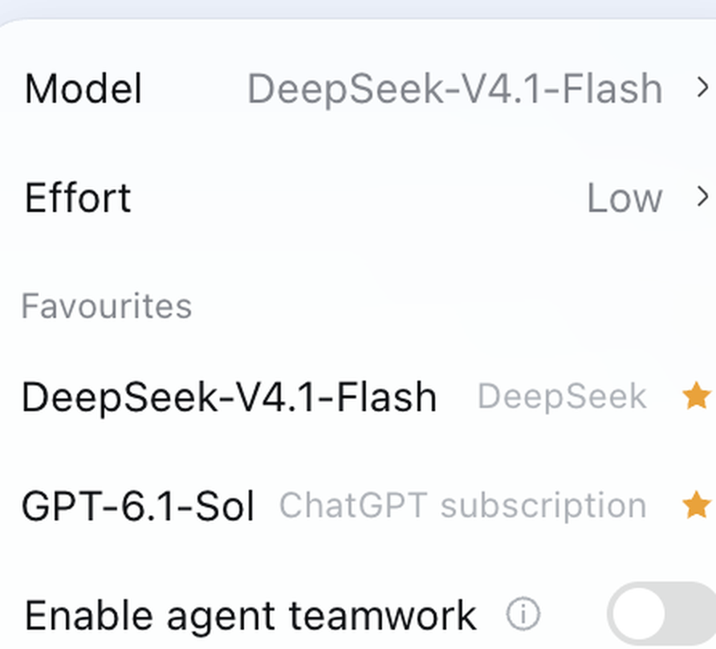

# DeepSeek Harness のお気に入りモデル

[](LICENSE)
[](https://github.com/deepseek-ai/deepseek-harness)

[](https://www.npmjs.com/package/dsh-favorite-models)

[English](README.md) | [Русский](README.ru.md) | [中文](README.zh.md) | 日本語 | [Español](README.es.md) | [Français](README.fr.md) | [Deutsch](README.de.md) | [Português](README.pt.md)

DeepSeek Harness の Web UI に星を追加するプラグインです。モデル一覧で任意のモデルに
星を付けると、セレクターのルートメニューに「お気に入り」ブロックが現れ、ワンクリックで
そのモデルに切り替えられます。モデル自体はプロバイダーのグループ内に残ります。

| 星付きのモデル一覧 | 「お気に入り」ブロック |
| --- | --- |
|  |  |

## 機能

- モデル一覧の各モデル名のすぐ後ろに星が表示されます。
- 星をクリックするとお気に入りに追加、もう一度クリックすると解除します。
- セレクターのルートメニューに「お気に入り」ブロック: 登録したモデルとプロバイダー名、
  現在のモデルにはチェックマーク、解除用の星が付きます。
- お気に入りの行をクリックするとそのモデルに切り替わり、メニューが閉じます。
- お気に入りはすべてのセッションで共有され、DSH を再起動しても保持されます
  （ブラウザーの `localStorage` に保存）。
- DSH のすべての標準言語にローカライズ済み。言語の切り替えは再読み込みなしで即座に
  反映されます。

## インストール

要件: DeepSeek Harness `0.2.2-rc.3` 以降、Web UI（デスクトップ版または
`dsh --profile web`）。

### 方法 1 — プラグインマーケット（Discover）

1. **Plugins → Discover** を開きます。
2. **Add index source** をクリックし、インデックスの URL を追加します:

   ```text
   https://raw.githubusercontent.com/DewFill/dsh-favorite-models/main/index.json
   ```

3. 一覧から **お気に入りのモデル**（Favourite models）を見つけ、**Install** を
   クリックします（バンドルのインストール確認があります）。

この方法でインストールすると、更新は同じ Discover タブから届きます。

### 方法 2 — ローカルフォルダーから

```bash
git clone https://github.com/DewFill/dsh-favorite-models.git
```

**Plugins → Installed → Add plugin** を開き、`dsh-favorite-models` フォルダーを
選択します。プラグインはすぐに有効になります。ウィンドウを既に開いていて星が表示
されない場合は、ページを再読み込みしてください。

### 方法 3 — npm パッケージ

**Plugins → Installed → Add plugin** を開き、`dsh-favorite-models` を入力して
プレビューを確認し、インストールを確定します。パッケージは provenance 付きで npm
に公開されているため、インストールされたコードはこのリポジトリまで追跡できます。

更新はプラグインカードの **Plugins → Installed → Update** から行います。

## 使い方

1. 入力欄の下にあるモデル名（例: 「DeepSeek-V4.1-Flash」）をクリックします。
2. **Model** ペインで、目的のモデル名の後ろの星をクリックします（黄色になります）。
3. もう一度モデルメニューを開くと、**Model** と **Effort** の行の下に
   **Favourites** ブロックが表示されます。行をクリックするとそのモデルに切り替わります。

## 言語

プラグインの文言と Plugins のカードは、英語・ロシア語・中国語・日本語・スペイン語・
フランス語・ドイツ語・ポルトガル語にローカライズされています。言語は DSH の設定
（**Settings → General → Language**）から取得され、即座に反映されます。それ以外の
言語では英語が使われます。この README は対応するすべての言語で用意されています
（先頭のリンクを参照）。

## 仕組み

プラグインは DSH の UI をコピーも置き換えもしません。標準のモデルセレクター
（[`@deepseek-ai/dsh-client-ui-model-selection`](https://github.com/deepseek-ai/deepseek-harness)）
の、文書化された 2 つのスロットを使います:

- `conversation.input.model.label` — 一覧の各行のモデル名の後ろに星を追加します;
- `conversation.input.model.options` — ルートメニューに、他のプラグインの行と並んで
  お気に入りブロックを追加します。

そのため DSH のデザイン変更でプラグインが壊れることはありません。最悪の場合でも、
星とお気に入りブロックが表示されなくなるだけです。

## 制限

- 「お気に入り」ブロックは **Model** と **Effort** の行の後に置かれます。このスロットは
  そこにしか項目を追加できません。モデル一覧の先頭に独立したグループを置くには標準の
  セレクターを丸ごと置き換える必要があり、それは意図的に避けています。
- 星はモデルの行に表示されます。折りたたまれた入力欄のトリガーと **Model** の行には
  表示されません。
- お気に入りはブラウザー内（`localStorage`、キー `dsh.favorite-models.v1`）に保存され、
  ブラウザーやデバイス間で同期されません。

## 更新と削除

- **更新:** **Plugins → Discover** → プラグインのカード → **Update**（Git から
  インストールした場合）、または `git pull` 後にフォルダーから再インストールします。
- **削除:** **Plugins → Installed** → バンドルを削除します。お気に入りは
  `localStorage` に残り、再インストールすると復元されます。

## 開発

```
.
├── client.js          # ブラウザー側: スロット、星、お気に入りブロック
├── index.js           # Host 側（空: すべて Client に実装）
├── cordis.patch.yml   # プロファイル用のバンドル行
├── package.json       # バンドルとクライアントモジュールのマニフェスト
├── index.json         # GitHub からのインストール用プラグインマーケット索引
├── locale/*.json      # 言語ごとのタイトル・説明・docs/DETAIL.md へのリンク
├── docs/DETAIL.md     # プラグイン詳細ページの説明
├── docs/screenshots/  # README 用スクリーンショット
└── icon.svg           # プラグインのアイコン
```

構文チェックとローカルインストール:

```bash
node --check client.js
node --check index.js
```

その後 **Plugins → Installed → Add plugin** でこのフォルダーを選択します。
`client.js` の変更はページの再読み込み後に反映されます（`pnpm run dev:web` が
動いていれば HMR でも反映されます）。

## ライセンス

[MIT](LICENSE) © Artemy Fedorchenko
